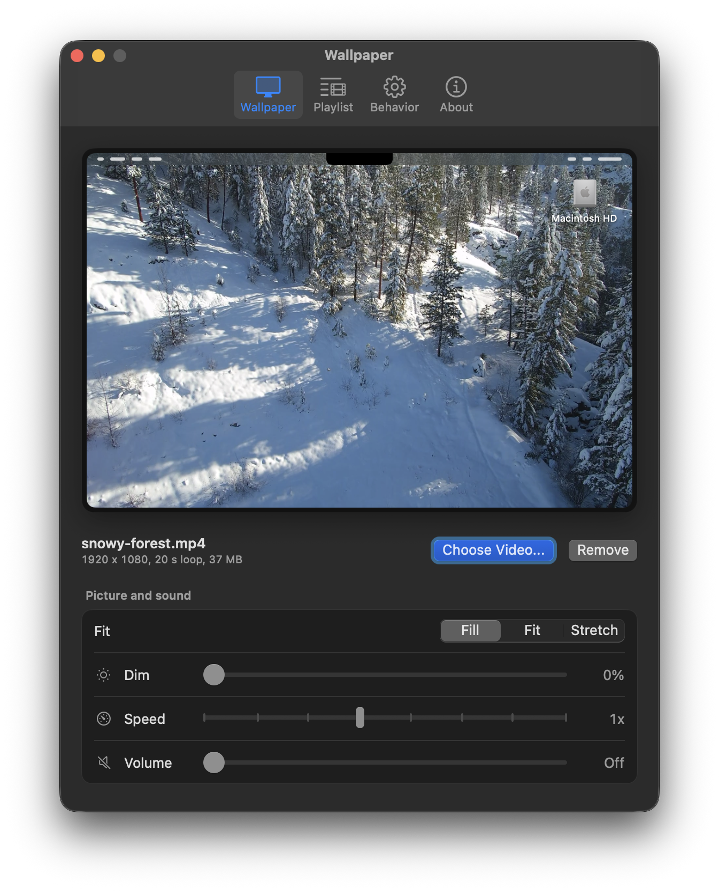
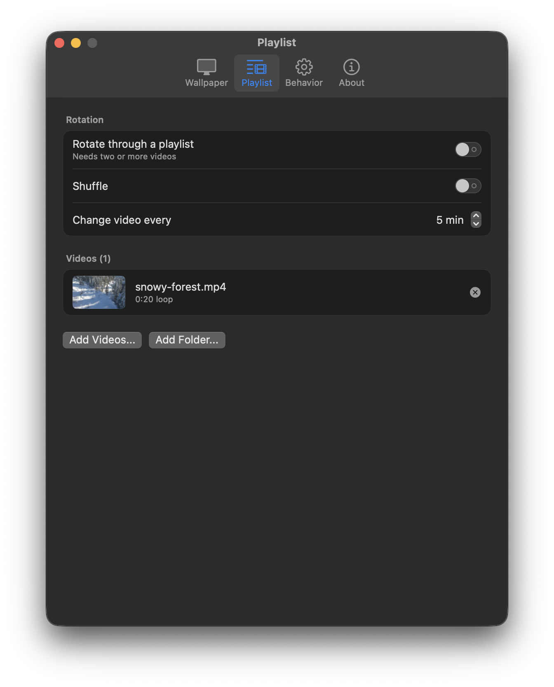
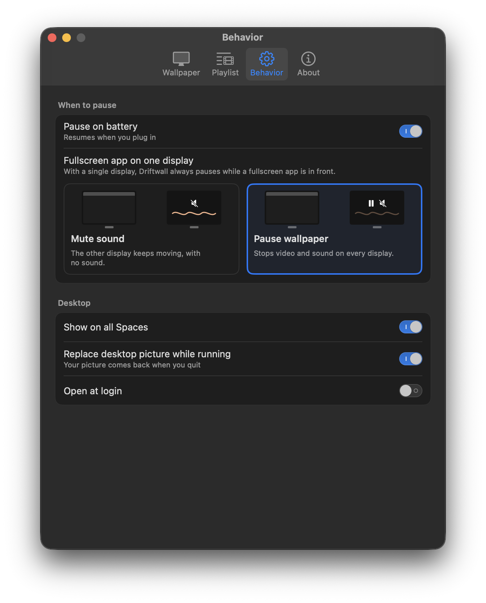

# Driftwall

Live video wallpaper for macOS. Pick an `.mp4` or `.mov` and it plays, looping seamlessly,
behind your desktop icons on every display, while you keep using your Mac normally.

Free and open source under the [MIT license](LICENSE). Website: https://driftwall.kamaldhital.com

  
  
  

The preview shows a [CC0 clip from Wikimedia Commons](https://commons.wikimedia.org/wiki/File:Fresh_Powder_coats_the_forests_of_Gallagher%27s_Canyon,_British_Columbia.webm).

## Features

- One video across all displays, or a different video per display.
- Playlists with scheduled rotation and optional shuffle.
- Fit mode (fill / fit / stretch), volume, dim, and playback speed.
- Pauses on battery or when a fullscreen app is frontmost. With several displays, a
  fullscreen app on one of them mutes the wallpaper (or pauses it, your choice).
- Launch at login. Lives in the menu bar, no Dock icon.
- No Screen Recording or Accessibility permission. Fullscreen detection reads window bounds
  only, never window contents.

Runs on macOS 13 (Ventura) or later.

## Install

With Homebrew:

    brew install --cask dhitalkamal/tap/driftwall

Or download `Driftwall.dmg` from the [latest release](https://github.com/dhitalkamal/driftwall/releases/latest),
open it, and drag Driftwall into Applications.

### First launch

Driftwall is not notarized yet (that needs a paid Apple developer account), so macOS blocks
the first launch with a "cannot be opened" message. Open it once with either:

- Right-click Driftwall in Applications, choose Open, then Open again.
- Or in Terminal: `xattr -dr com.apple.quarantine /Applications/Driftwall.app`

After that it opens normally. The source is all here if you would rather build it yourself.

## Build from source

Needs the Swift toolchain. The Xcode command line tools are enough to build and test; full
Xcode is only needed to notarize for distribution.

    scripts/install.sh          # build + install to /Applications, then launch from Spotlight

Or build the bundle without installing:

    scripts/build_app.sh        # produces dist/Driftwall.app (ad-hoc signed for local use)
    open dist/Driftwall.app

Or run without bundling:

    swift run DriftwallApp

The app lives in the menu bar (no Dock icon). Click the icon, choose a video, or open
Settings. Quitting removes the wallpaper and reveals your normal desktop.

## Tests

    swift run DriftwallCoreTests

Exit code 0 means all passed. The runner is a small dependency-free harness (see
`Tests/DriftwallCoreTests/TestRunner.swift`) so tests run under the command line tools, where
neither XCTest nor the swift-testing macro plugin is available. It ports to XCTest easily.

## How it works

macOS has no public API to set a video as the desktop picture, so Driftwall uses the standard
(unofficial) technique: a borderless NSWindow per screen at the desktop window level.

- Window level `CGWindowLevelForKey(.desktopWindow)` sits above the static desktop picture
  and below the icons. Collection behavior `[.canJoinAllSpaces, .stationary, .ignoresCycle]`;
  `.stationary` is required or the window vanishes in Mission Control. The window ignores
  mouse events so clicks pass through.
- Video plays through `AVQueuePlayer` + `AVPlayerLooper` for gapless looping, with a dim
  overlay layer and per-fit-mode video gravity.
- Playback pauses on a fullscreen app or on battery, driven by a pure playback policy fed by
  IOKit power state, window occlusion, and the window server's on-screen window list
  (bounds only, so no Screen Recording permission is needed).

## Architecture

Hexagonal layering, imports flow inward only:

- `Sources/DriftwallCore` (pure, no AppKit): domain and application logic. Domain holds
  PlaybackPolicy, WallpaperConfig, FitMode, Playlist/RotationState, PlaybackSettings, and
  PlaybackState. Application holds WallpaperController, WallpaperResolver, and the ports.
- `Sources/DriftwallApp` (AppKit/AVFoundation/IOKit): adapters that implement the ports, the
  SwiftUI preferences window, and the menu bar.

## Limitations

- Desktop only. Lock Screen video is not shipped (it needs native wallpaper APIs macOS does
  not expose to third parties).
- Not sandboxed and not Mac App Store distributable, by nature of the desktop window technique.
- The desktop window level is an undocumented technique. Stable for years across many apps,
  but retest on each annual macOS release.
- "Replace system wallpaper" acts per Space. macOS only lets an app read/write the active
  Space's desktop picture, so if you use per-Space wallpapers, only Spaces you visit while
  Driftwall runs are taken over and restored. The captured originals are saved to disk and
  recovered on the next launch if the app crashes or is force-quit, so your wallpaper is not
  lost; turn the setting off if you rely heavily on distinct per-Space wallpapers.

## Contributing

Issues and pull requests are welcome. Please keep changes focused, run
`swift run DriftwallCoreTests` before opening a PR, and match the existing hexagonal layering
(no AppKit/AVFoundation imports in `DriftwallCore`).

## License

[MIT](LICENSE) © Kamal Dhital
